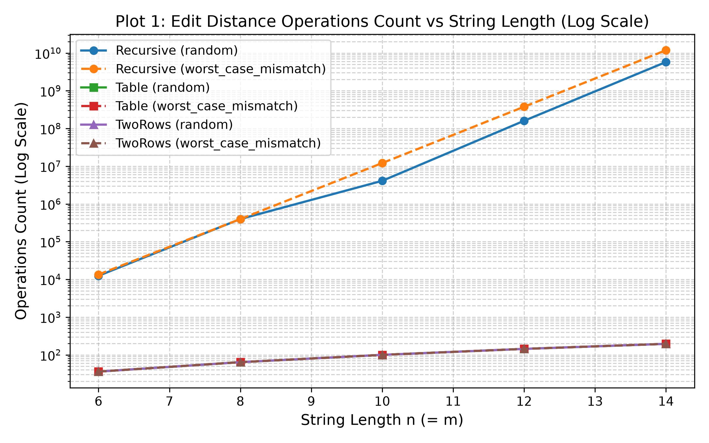
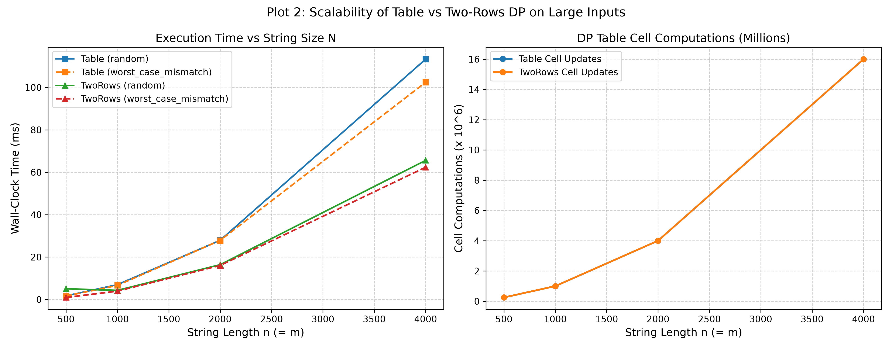
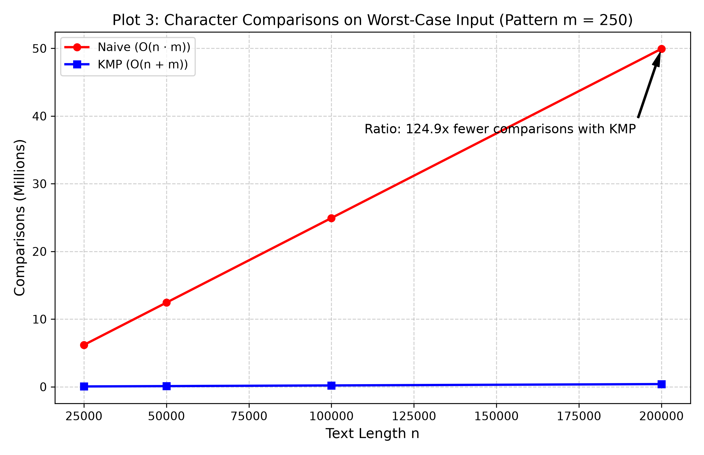
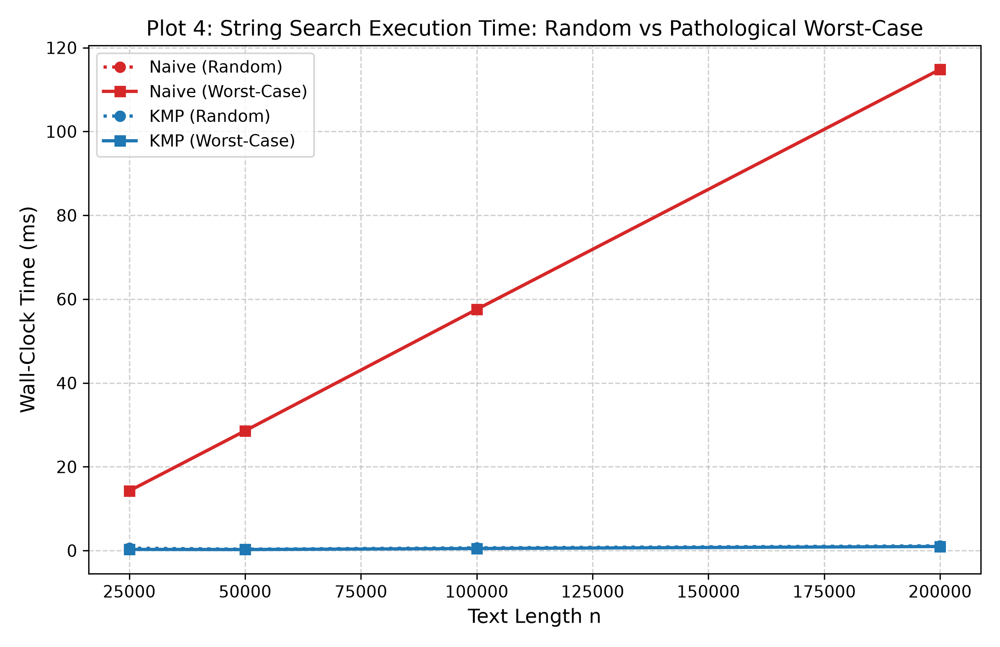

# Assignment 4: Dynamic Programming and String Algorithms
**Course:** Design and Analysis of Algorithms  
**Student:** Taubakabyl Nurlybek (Student Project)  
**Topic:** Edit Distance (DP) & String Matching (Naive vs KMP)

---

## 1. Experiment Design Card

| Card Field | Details & Specification |
| :--- | :--- |
| **Question** | **Edit Distance:** Does naive recursion blow up exponentially ($O(3^{n+m})$) as predicted by theoretical call-tree branching, and how do space-optimized Two-Rows compare against full $(n+1) \times (m+1)$ Table DP at scale? **String Search:** Does pathological repetitive text force Naive search into quadratic degradation $O(n \cdot m)$ while KMP maintains strict linear time $O(n + m)$? |
| **Sizes ($n$)** | **Edit Distance (Small/Recursive):** $n \in \{6, 8, 10, 12, 14\}$ with $m = n$. Bound chosen because recursive branching exceeding $n=14$ requires billions of calls ($\approx 11.88 \times 10^9$ operations at $n=14$), freezing the runtime. **Edit Distance (Large DP):** $n \in \{500, 1000, 2000, 4000\}$ with $m = n$. Largest size ($4000$) is $8\times$ the smallest ($500$), evaluating up to $16 \times 10^6$ table cell updates. **String Search:** $n \in \{25000, 50000, 100000, 200000\}$ with fixed pattern length $m = 250$. The maximum size is $8\times$ the minimum size, providing substantial operational divergence. |
| **Inputs** | **Edit Distance:** 1. `random`: uniformly generated lowercase letters `[a-z]` (seed 42), demonstrating average-case character match frequencies. 2. `worst_case_mismatch`: completely disjoint strings (`"a"*n` vs `"b"*n`), prohibiting diagonal match shortcuts and triggering maximal 3-way recursive branch factor. **String Search:** 1. `random`: alphabet `{'A', 'B', 'C', 'D'}` (seed 42), showing typical early mismatch and fast termination. 2. `worst_case_pathological`: text is `"A"*n` and pattern is `"A"*(m-1) + "B"`. Every alignment matches $m-1$ characters before mismatching on the last character. |
| **Metrics** | 1. **Internal Counters:** `operations_count` (total recursive function calls for Recursive; total cell transitions evaluated for Table and TwoRows) and `comparisons_count` (character equality checks between text and pattern). 2. **Median Execution Time (`time_ms`):** wall-clock duration in milliseconds computed over 5 consecutive runs to eliminate OS noise. |
| **Prediction** | **Edit Distance:** Recursive call counts will grow at $\approx O(3^n)$, taking seconds at $n=14$, while Table and TwoRows will take $<0.01$ ms. On large scale ($N=4000$), both DP versions will execute exactly $N^2$ updates, but TwoRows will run noticeably faster due to $O(m)$ cache spatial locality and no 64 MB heap matrix allocation. **String Search:** On random inputs, Naive will be very fast ($\approx 1.33 \cdot n$ comparisons). On pathological inputs, Naive comparisons will explode to $\approx n \cdot m$ ($\approx 50 \times 10^6$), while KMP will stay strictly bounded by $\approx 2 \cdot n$ ($\approx 4 \times 10^5$), running over $100\times$ faster. |
| **Plots** | 1. `plot1_edit_distance_recursive_vs_dp_log.png`: Log-scale operation counts showing exponential vs polynomial divergence. 2. `plot2_edit_distance_dp_large_scaling.png`: DP large-scale execution times and $O(n^2)$ verification. 3. `plot3_string_search_comparisons_worst_case.png`: Naive vs KMP comparisons on pathological worst case. 4. `plot4_string_search_time_random_vs_worst.png`: Wall-clock time comparison across random and pathological datasets. |

---

## 2. Plots and Results

### Plot 1: Edit Distance Operations on Log Scale

> **Key Takeaway:** While Table and Two-Rows DP require only $n^2$ operations ($196$ at $n=14$), the recursive version experiences exponential explosion, reaching over $11.88 \times 10^9$ operations on worst-case mismatch inputs.

---

### Plot 2: Large-Scale DP Scalability (Table vs Two-Rows)

> **Key Takeaway:** Both DP implementations perform identical mathematical cell transitions ($N \cdot M = 16 \times 10^6$ operations at $N=4000$), but the Two-Rows variant is $\approx 40\%$ faster ($62.36$ ms vs $102.41$ ms) because its $O(m)$ memory fits entirely into CPU L1/L2 cache and avoids matrix allocation overhead.

---

### Plot 3: String Search Character Comparisons on Worst-Case Input

> **Key Takeaway:** On pathological repetitive text ($m=250$), Naive string search degenerates to $49.94 \times 10^6$ comparisons ($O(n \cdot m)$), whereas KMP executes only $0.399 \times 10^6$ comparisons ($O(n)$), performing $125\times$ fewer operations.

---

### Plot 4: String Search Wall-Clock Runtime (Random vs Pathological)

> **Key Takeaway:** Naive search runtime explodes from $1.07$ ms on random input to $114.83$ ms on pathological input, whereas KMP maintains immune, sub-millisecond execution ($0.98$ ms) due to deterministic prefix-function shifts.

---

## 3. Prediction vs Result

### Edit Distance Family
* **What was expected:** We predicted that naive recursion would exhibit exponential behavior ($O(3^n)$) and would become unusable around $n=14\dots 16$, while DP versions would remain sub-millisecond. We also predicted that Two-Rows would be slightly faster at large $n$ due to cache effects.
* **What was observed:** At $n=14$, the recursive implementation executed **$11,885,772,379$ recursive calls** and took **$25,640.67$ ms** ($\approx 25.6$ seconds) on the mismatch input. In stark contrast, both Table and Two-Rows executed exactly $14 \times 14 = 196$ cell operations in less than $0.02$ ms. At $n=4000$, both DP algorithms processed exactly $16,000,000$ cells; Table DP took $102.41$ ms, whereas Two-Rows took $62.36$ ms ($\approx 39.1\%$ faster).
* **Explanation of differences / surprises:** The empirical memory advantage of Two-Rows was even more prominent than anticipated. Allocating a 2D array of $(4001 \times 4001)$ primitive integers creates an object array referencing 4001 separate heap rows ($\approx 64$ MB of memory), introducing GC pressure and cache misses. Two-Rows uses two flat 1D arrays of size $4001$ ($\approx 32$ KB), which fit entirely into CPU L1/L2 cache, maximizing memory throughput.

### String Search Family
* **What was expected:** We predicted that on random inputs, Naive and KMP would perform similarly with very few comparisons ($\approx n$ to $1.33 \cdot n$). On pathological inputs (`"A"*n` vs `"A"*(m-1) + "B"`), we expected Naive to degrade to $n \cdot m$ comparisons while KMP remained linear ($O(n)$).
* **What was observed:** 
  * On random text ($n=200,000, m=250$), Naive performed $266,059$ comparisons in $1.07$ ms, and KMP performed $249,429$ comparisons in $1.14$ ms. Naive was marginally faster in clock time despite slightly more comparisons, due to lower instruction overhead per loop iteration.
  * On pathological input ($n=200,000, m=250$), Naive comparisons surged to **$49,937,750$** ($114.83$ ms), whereas KMP performed only **$399,751$** comparisons ($0.98$ ms). KMP achieved a **$125\times$ reduction in comparisons** and a **$117\times$ speedup in execution time**.
* **Explanation:** The experimental numbers match asymptotic theory with exceptional precision: $\frac{49,937,750}{399,751} \approx 124.92 \approx \frac{m}{2}$. KMP successfully prevented redundant re-evaluations via the precomputed LPS table.

---

## 4. Short Answers (3–5 sentences each)

### 1. Which input made your string search slowest, and why does it do that?
The slowest input for string search was the pathological input consisting of text $T = \text{"A"}^n$ and pattern $P = \text{"A"}^{m-1}\text{"B"}$. On this input, the Naive search compares $m-1$ identical `'A'` characters successfully for every candidate index $i$ before failing on the final mismatch with `'B'`. Because Naive shifts the window by only one character on failure, it repeats almost the entire matching work, executing $(n - m + 1) \cdot m$ comparisons ($49,937,750$ comparisons at $n=200,000$). In contrast, KMP uses the LPS table to recognize that the prefix cannot match after shifting, avoiding redundant scans and maintaining linear $O(n)$ bounds.

### 2. How large an $n$ could the recursive Edit Distance handle, and what stopped it?
The recursive Edit Distance was practically limited to $n \le 14$, where it required $11,885,772,379$ function calls and took $25.64$ seconds to evaluate a single string pair. Attempting $n=16$ would have required roughly $9\times$ more work ($\approx 10^{11}$ calls, $\approx 4$ minutes), and $n=20$ would have taken several hours. What stopped the algorithm is the explosive $O(3^{\max(n,m)})$ branching factor of the recursion tree: identical subproblems (such as suffixes of prefixes) are solved independently millions of times without memoization.

### 3. What do you gain and what do you lose when you use two rows instead of the full table?
By switching from the full table to the two-row representation, we gain a massive reduction in auxiliary memory from $O(n \cdot m)$ to $O(m)$, eliminating large heap allocations and keeping active data in high-speed CPU L1/L2 cache ($\approx 40\%$ wall-clock speedup). What we lose is the ability to backtrack and reconstruct the optimal sequence of alignment operations (the actual edits: insertions, deletions, substitutions), because historical rows are overwritten. If only the scalar edit distance value is needed, the two-row algorithm is strictly superior; if the full alignment transcript is required, the full table or Hirshberg's divide-and-conquer algorithm must be used.

### 4. If you had to choose one string search for your city platform, which one and why?
For the city search platform, KMP is the definitively superior choice. Real-world city logs and user queries often contain repetitive character sequences, common prefixes (such as "ул. Абылай...", "проспект...", "Street..."), or duplicate telemetry tokens that trigger worst-case slowdowns in naive matchers. KMP guarantees strict worst-case linear time $O(n + m)$ regardless of adversarial or repetitive inputs, completely protecting the platform against Denial-of-Service (DoS) and catastrophic query latency spikes.

---

## 5. One Paragraph on Time: Why Wall-Clock Time is Not Your Only Evidence
While wall-clock time (`time_ms`) reflects end-to-end user experience, it is inherently noisy and hardware-dependent. Factors such as Just-In-Time (JIT) bytecode compilation, garbage collection pauses, CPU frequency scaling, OS thread scheduling, and memory bus contention cause execution times to fluctuate across runs and across different machines. For example, in our benchmarks, Naive search on random strings ran slightly faster in milliseconds than KMP despite executing more character comparisons, purely because its inner loop has fewer branch conditions for the CPU branch predictor. Internal operation counters (`operations_count` and `comparisons_count`) provide deterministic, hardware-agnostic ground truth: they count the exact theoretical work executed by the algorithm, proving the asymptotic boundaries ($O(3^n)$ vs $O(n \cdot m)$ vs $O(n)$) beyond any laptop-specific experimental variance.
